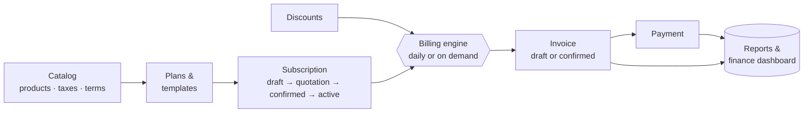
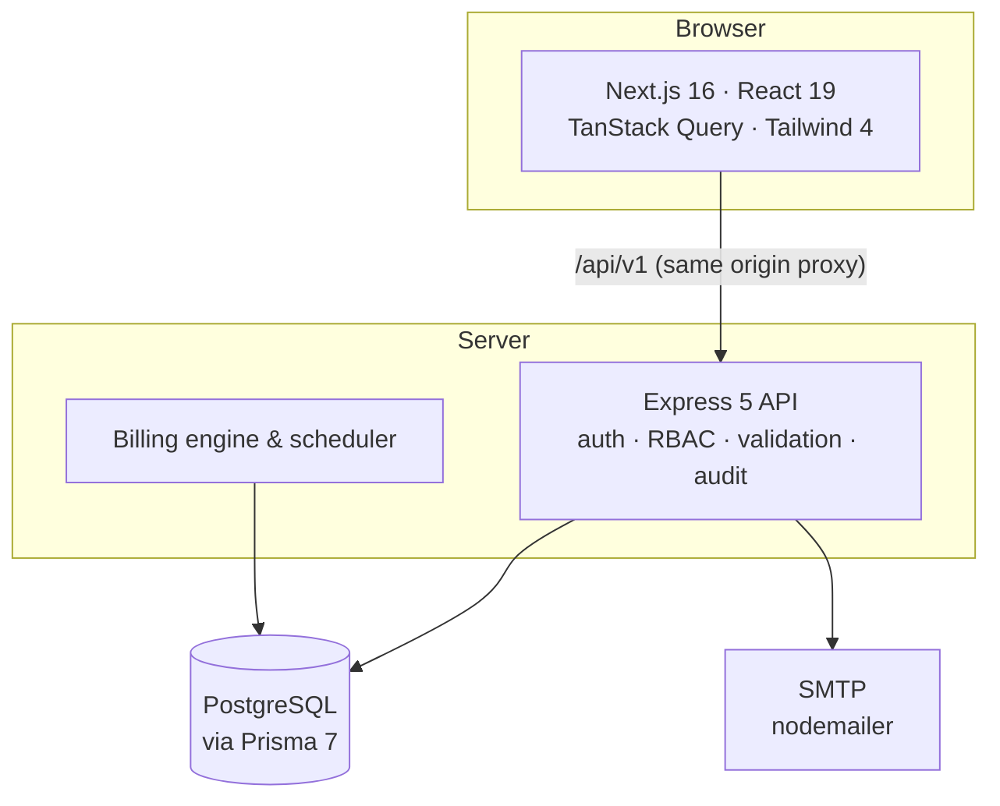

<div align="center">

# Brightloop Billing

**Subscription management, recurring invoicing and revenue reporting in one place.**

Quotation → subscription → invoice → payment → finance dashboard, with every step automated, audited and safe to run at scale.


</div>

---

## What is it?

Brightloop sells software on a recurring basis. Every month somebody has to remember which customers are subscribed to
what, work out what each of them owes after discounts and tax, produce the invoices, chase the payments and tell
management where the revenue stands. Done by hand that is spreadsheets, retyped numbers and an end-of-quarter scramble.

**Brightloop Billing replaces all of that with one system.** Staff set up a catalog once, turn customers into
subscribers with a few clicks, and the platform issues the right invoice on the right day, records payments, and keeps a
live picture of revenue, outstanding balances and overdue accounts.

## What it does

| | |
|---|---|
| **Catalog** | Products (services or goods) with variants and per-product taxes, tax rates, and payment terms such as *Net 15* or *Due on receipt*. |
| **Plans** | Recurring billing cycles: daily, weekly, monthly or yearly, every *N* periods (quarterly is monthly × 3), with availability windows, minimum quantity, and rules for pausing, early close, renewal and auto-close. |
| **Quotation templates** | A plan plus a set of products, ready to start a new subscription in one click. Each template reports whether it is usable today and why not. |
| **Subscriptions** | A guided lifecycle: *Draft → Quotation → Confirmed → Active*, with pause, resume, close and renew. Every transition is validated, recorded in a history, and protected against two people editing at once. |
| **Discounts** | Percentage or fixed, applied to specific products or to a whole subscription, with date windows, minimum purchase or quantity, and a usage limit that can never be exceeded. |
| **Recurring billing** | A billing engine turns every due subscription into an invoice with the correct lines, discounts and tax. It runs on demand or from a daily scheduler that admins switch on and configure inside the app. |
| **Invoices** | Draft for review or confirmed straight away, numbered sequentially, printable, and frozen as a snapshot so later price changes never rewrite history. |
| **Payments** | Record full or partial payments against an invoice. Retries are safe, overpayment is impossible, and a fully paid invoice settles itself and emails a receipt. |
| **Finance dashboard** | Monthly recurring revenue, money collected, invoiced, outstanding and overdue, revenue over time, and drill-down reports by invoice, payment, overdue ageing and plan. |
| **Customer portal** | Customers sign in to see their own subscriptions and invoices, and keep their billing details up to date. |
| **Team & security** | Role-based access, password reset by email, an audit trail of every important change, and a light and dark interface. |

## Who uses it

Three roles, each seeing exactly what they need.

| Role | Purpose | Can do |
|---|---|---|
| **Admin** | Runs the business setup | Everything: manage the catalog, plans, templates and discounts; start billing runs and configure the scheduler; manage the team; plus all staff actions. |
| **Staff** | Runs day-to-day operations | Create and manage customers and subscriptions, review and confirm invoices, record payments, read the catalog and every report. |
| **Customer** | Self-service | See their own subscriptions and invoices, update their own billing details. Nothing else, and never anyone else's data. |

## The impact

- **Revenue stops leaking.** Every active subscription is billed on its due date, once. Nothing is forgotten and nothing is billed twice.
- **Numbers can be trusted.** Money is stored exactly (no floating-point drift), invoices reconcile to the cent, and totals are verified by the database itself.
- **Finance sees the truth instantly.** Outstanding, overdue and recurring revenue are one click away and answer in well under two seconds, even over about 100,000 invoices.
- **Staff time goes to customers, not spreadsheets.** Templates, one-click lifecycle actions and automatic billing remove the repetitive work.
- **Customers get clarity.** Clear invoices, an honest payment history and a portal that is theirs alone.
- **It scales without rework.** The same design that serves a handful of subscribers serves tens of thousands, on one server or many.

---

## How it works



**A billing day, end to end.** The engine finds every active subscription whose next billing date has arrived, claims
them safely, builds each invoice (product-level discounts first, then subscription-level discounts, then tax), records
which discounts were used, and moves the subscription to its next billing date, all in a single database transaction
per invoice. If one invoice fails, it is reported and the rest carry on.

## Architecture



### Stack

| Layer | Technology |
|---|---|
| Frontend | Next.js 16 (Cache Components), React 19, TanStack Query, react-hook-form + Zod, Tailwind CSS 4, hand-built SVG charts |
| Backend | Node 22+, Express 5, TypeScript (strict, ESM), Zod validation, Pino structured logging |
| Data | PostgreSQL (local or Supabase) through Prisma 7 with the `pg` driver adapter |
| Auth | argon2id password hashing, short-lived JWT access tokens, rotating refresh tokens |
| Email | nodemailer, with a log-only mode for development |

### Key architectural decisions

**Money is exact.** Every amount is `NUMERIC(12,2)` in the database and a decimal type in code, never a floating-point
number. The API returns money as strings. Discounts are split across lines with a largest-remainder allocation, so the
cents always add up.

**Billing is idempotent by construction.** A partial unique index on `(subscription, period start)` makes a second
invoice for the same period impossible, whatever happens. Due subscriptions are claimed with
`SELECT … FOR UPDATE SKIP LOCKED`, so any number of workers can run side by side without overlapping.

**One transaction per invoice.** Claiming, building the invoice, redeeming discounts and advancing the schedule commit
together or not at all. A crash can never leave a subscription half-billed.

**The scheduler lives in the app, not in config.** On/off, start hour and draft-or-confirm behaviour are stored in a
database row that admins edit on the Billing page. Every API instance checks it on a timer, and a unique index guarantees
only one scheduled run per day, so scaling out is safe and changes apply within minutes with no redeploy.

**Discount limits are enforced where they cannot be bypassed.** Usage is incremented by a guarded `UPDATE` that refuses
to pass the limit, with a database `CHECK` as the backstop, and a discount can only be redeemed once per invoice.

**Payments are serialised per invoice.** Each payment locks its invoice row, adds the payment, updates the balance and
settles the invoice in one transaction. An idempotency key makes client retries safe, and a database constraint rejects
overpayment even if application code were wrong.

**Invoices are snapshots.** Prices, tax rates and customer details are copied onto the invoice when it is created, so
editing the catalog never alters an invoice that has already been issued.

**Overdue is derived, not stored.** An invoice is overdue when it is confirmed, unpaid and past its due date. There is no
flag to drift out of date, and a partial index keeps the lookup fast.

**Safe concurrent edits.** Subscriptions carry a version number (optimistic locking) and a status history, so two people
editing at once get a clear conflict instead of silently overwriting each other.

**Sessions designed for the browser.** The refresh token travels in an httpOnly cookie while the access token stays in
memory. The frontend proxies `/api/v1` to the API so the cookie is first-party, and a single-flight refresh prevents
request storms. Refresh tokens rotate, and reuse of an old one revokes the whole token family.

**Customers can only ever see their own data.** The restriction is applied inside every query, not filtered afterwards,
and role checks sit on every route.

**Reports are computed in SQL.** All aggregation happens in indexed queries, with keyset pagination for long lists, so
the dashboard stays fast as data grows.

**Consistent, predictable API.** One error shape, `{ error: { code, message, details? } }`; one list shape,
`{ items, page, limit, total, totalPages }`; validated input on every route; soft deletes on master data; an audit entry
for every meaningful change.

**Database safety by default.** Row-level security is enabled on every table with no public policies, so Supabase's
public data API cannot reach anything. Constraints, partial indexes and `CHECK`s live in hand-written migrations next to
the generated ones.

**A calm, accessible interface.** A black-and-white design system built on semantic tokens, a light/dark switch with no
flash on load, keyboard-friendly charts with table views, and screens that work down to phone width.

---

## Project structure

```
.
├── backend/
│   ├── prisma/                 schema and migrations (generated + hand-written constraints)
│   ├── scripts/                demo data, performance checks, integration test runner
│   ├── src/
│   │   ├── config/             validated environment
│   │   ├── lib/                database client, logging, errors, money and date helpers
│   │   ├── middleware/         auth, roles, validation, error envelope
│   │   ├── modules/            auth · users · customers · catalog · plans · discounts
│   │   │                       subscriptions · billing · invoices · payments · reports
│   │   └── test/               integration suites
│   ├── ARCHITECTURE.md         design decisions in depth
│   └── MODULES.md              module-by-module reference and endpoint tables
└── frontend/
    ├── app/                    routes (thin server components)
    ├── components/             design-system primitives, app shell, theme and background
    ├── features/               one folder per area: customers · subscriptions · invoices
    │                           billing · reports · catalog · plans · templates · discounts
    └── lib/                    API client, auth, formatting, theme
```

Each backend module owns its routes, validation schemas and service. Routes stay thin, services hold the logic, and
modules talk to each other service-to-service.

## Getting started

**You need** Node.js 22 or newer and a PostgreSQL database, either local or a [Supabase](https://supabase.com) project.

### 1. Backend

```bash
cd backend
cp .env.example .env        # then edit: database URLs and a long random JWT_ACCESS_SECRET
npm install
npm run db:migrate:deploy   # create the schema
npm run db:seed             # first admin account and default payment terms
npm run dev                 # API on http://localhost:4000
```

For Supabase, use the pooled connection string (port 6543) as `DATABASE_URL` and the direct connection string
(port 5432) as `DIRECT_URL`. Leave `SMTP_HOST` empty in development and outgoing emails are written to the API log
instead of being sent.

### 2. Frontend

```bash
cd frontend
cp .env.example .env        # BACKEND_URL defaults to http://localhost:4000
npm install
npm run dev                 # app on http://localhost:3000
```

Sign in with the admin account from your seed settings (`ADMIN_EMAIL` and `ADMIN_PASSWORD` in `backend/.env`).

### 3. Try it with sample data

```bash
cd backend
npm run demo:seed           # a realistic set of customers, subscriptions, invoices and payments
npm run demo:clear          # remove it again
```

The demo creates three logins, `admin@demo.test`, `staff@demo.test` and `customer@demo.test`, all with the password
`Demo!Passw0rd1`.

## Quality

| Command | What it runs |
|---|---|
| `npm test` (backend) | Unit tests for the pure logic: money, schedules, discount rules, validators. |
| `npm run test:integration` (backend) | Real HTTP tests against the database in `.env`: auth, catalog, billing, discounts, payments, reports. All test data is tagged and removed afterwards. |
| `npm test` (frontend) | Logic tests for pricing previews, lifecycle rules, date ranges and chart scales. |
| `npm run typecheck` (both apps), `npm run lint` (frontend) | Strict TypeScript across both apps and ESLint on the frontend. |
| `npx tsx --env-file=.env scripts/perf-reports.ts` (backend) | Seeds about 100,000 invoices inside a rolled-back transaction and times every report. |

## Documentation

- [`backend/ARCHITECTURE.md`](backend/ARCHITECTURE.md): the design decisions and database setup in depth.
- [`backend/MODULES.md`](backend/MODULES.md): every module, endpoint, business rule and error code.

---

<div align="center">

Built for **Brightloop Software** · Abhiram & Pranav

</div>
